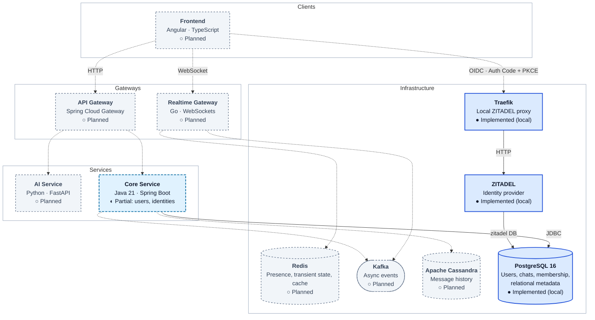

# Relay

Relay is a real-time messenger built as a polyglot microservices system. This repository is the central entry point: it holds the architecture documentation and links to the independent repositories that make up the project.

Relay is under early development. Most components are planned and not implemented yet; the table below shows the current status of each repository.

## Architecture

**Legend**

| Marker | Meaning |
|---|---|
| ● solid blue border | Implemented (local development only) |
| ◐ dashed blue border | Partially implemented |
| ○ dashed gray border | Planned |
| Solid arrow | Verified, currently implemented integration |
| Dashed arrow | Proposed integration, not implemented |

PostgreSQL holds users and identity links today; chats, membership and other relational metadata are planned there. Message history is planned for Cassandra. Traefik is only the local reverse proxy in front of ZITADEL, not an API gateway. Details are in the [architecture overview](docs/architecture/overview.md).

## Repositories

| Repository | Role | Stack | Status |
|---|---|---|---|
| [core-service](https://github.com/relay-systems/core-service) | User profiles and core messaging logic | Java 21, Spring Boot, PostgreSQL, Liquibase | **Partially implemented** |
| [infrastructure](https://github.com/relay-systems/infrastructure) | Local PostgreSQL, ZITADEL and Traefik | Docker Compose | **Implemented** (local development only) |
| [api-gateway](https://github.com/relay-systems/api-gateway) | Single entry point for clients | Java 21, Spring Cloud Gateway | **Planned** (repository setup only) |
| [realtime-gateway](https://github.com/relay-systems/realtime-gateway) | WebSocket gateway for real-time communication | Go, WebSockets | **Planned** (repository setup only) |
| [ai-service](https://github.com/relay-systems/ai-service) | AI-powered features | Python, FastAPI | **Planned** (repository setup only) |
| [frontend](https://github.com/relay-systems/frontend) | Web client | Angular, TypeScript | **Planned** (repository setup only) |

Status legend: **Implemented** (exists and runs), **Partially implemented** (some parts exist), **Planned** (documented intent only). Details are in the [architecture overview](docs/architecture/overview.md).

## Getting started

The only runnable parts today are PostgreSQL and ZITADEL (from `infrastructure`) and Core Service:

1. Start PostgreSQL, and optionally ZITADEL, as described in the [infrastructure](https://github.com/relay-systems/infrastructure) repository.
2. Build and run Core Service as described in the [core-service](https://github.com/relay-systems/core-service) repository.

## Documentation

- [Architecture overview](docs/architecture/overview.md): components, status and communication paths

## Branches

Every Relay repository follows the same flow: `TASK_<kebab-case>` -> `test` -> `main`, both through pull requests, enforced by the `branch-policy` workflow. Feature branches are created from `test`.
