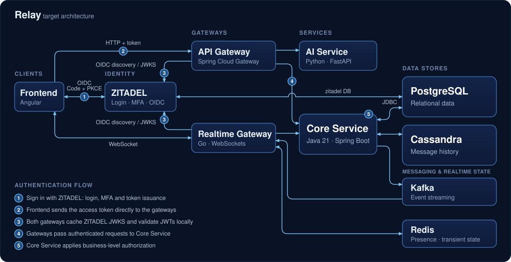

# Architecture Overview

Status as of 2026-10-21. This document separates what exists today from what is planned; nothing is described as working unless it has been verified.

## System overview

Relay is a real-time messenger built as a polyglot microservices system. The architecture is designed for high availability, scalability and low latency communication. Each service lives in its own repository under [relay-systems](https://github.com/relay-systems) and is built and deployed independently.

## Target architecture

The diagram shows the target architecture, not implementation status; status is tracked in the tables below. The "ZITADEL" card is the Identity Platform, and the numbered steps are the authentication flow described in [Authentication and authorization](#authentication-and-authorization). Traefik, the local reverse proxy in front of ZITADEL, is an infrastructure detail and is not drawn as a separate component. Redis, Kafka and Cassandra are planned and not deployed.

## Authentication and authorization

Planned design; none of it is implemented. Three separate concerns:

1. **Token issuance (ZITADEL).** The Frontend signs users in through ZITADEL with OpenID Connect, Authorization Code flow with PKCE, as a public client. ZITADEL handles login and MFA and issues the tokens. The Frontend must be configured to receive **JWT** access tokens; ZITADEL issues opaque tokens by default, and opaque tokens cannot be validated locally.
2. **JWT validation (API Gateway and Realtime Gateway).** The Frontend sends the access token to the API Gateway with each HTTP request and presents it to the Realtime Gateway when it opens a WebSocket connection. Each gateway independently validates the signature, issuer, audience and expiry locally. It retrieves ZITADEL's issuer configuration and public signing keys (JWKS) itself, caches them and refreshes them when keys rotate. ZITADEL is not called per request, so a token revoked before it expires is still accepted until expiry; token lifetimes should be short. Introspection would detect revocation but costs one ZITADEL call per request.
3. **Business authorization (Core Service).** Core Service decides what the authenticated user may do (for example chat membership and permissions), using the authenticated user identity (issuer and subject) that maps to a row in `user_identities`. Both gateways pass that identity to Core Service. ZITADEL holds no Relay business permissions.

Open decision: the internal service-to-service trust mechanism, that is, how Core Service trusts the identity passed by the gateways (for example re-validating the token or an internal credential).

## Status legend

| Status | Meaning |
|---|---|
| **Implemented** | Exists and runs |
| **Partially implemented** | Some parts exist, others are planned |
| **Planned** | Documented intent only; no implementation |

## Repositories and components

| Repository | Component | Stack | Status |
|---|---|---|---|
| [core-service](https://github.com/relay-systems/core-service) | Core Service | Java 21, Spring Boot | **Partially implemented** |
| [infrastructure](https://github.com/relay-systems/infrastructure) | PostgreSQL, ZITADEL, Traefik | Docker Compose | **Implemented** (local development only) |
| [api-gateway](https://github.com/relay-systems/api-gateway) | API Gateway | Java 21, Spring Cloud Gateway | **Planned** |
| [realtime-gateway](https://github.com/relay-systems/realtime-gateway) | Realtime Gateway | Go, WebSockets | **Planned** |
| [ai-service](https://github.com/relay-systems/ai-service) | AI Service | Python, FastAPI | **Planned** |
| [frontend](https://github.com/relay-systems/frontend) | Frontend | Angular, TypeScript | **Planned** |

The four **Planned** repositories contain only their project setup: a README, a `.gitignore` and CI workflows. They have no application code.

## Services

### Core Service: partially implemented

Owns application user profiles and core messaging logic.

Exists today:
- A Java 21 Spring Boot application with a health endpoint (`GET /api/v1/health`) and the Actuator `health` endpoint.
- A PostgreSQL connection through JDBC (database `relay`), configured with the `DB_URL`, `DB_USER` and `DB_PASSWORD` environment variables.
- Liquibase migrations that create the `users` and `user_identities` tables. A user is linked to an identity provider account by issuer and subject, and holds no credentials.
- A `local` profile with an opt-in tool that recovers from changed Liquibase changesets in local development only.

Planned, not implemented:
- User profile creation and lookup, and any other business logic.
- Business-level authorization and mapping of ZITADEL identities (issuer and subject) to users. There is no security dependency in the service yet. JWT validation is planned at the API Gateway and the Realtime Gateway; the trust mechanism between them and Core Service is an open decision.
- Message history storage in Apache Cassandra. Users, chats, membership and other relational metadata stay in PostgreSQL.
- Handling message creation commands from the Realtime Gateway: validating chat membership and permissions, persisting the message and publishing a `MessageCreated` event to Kafka.

### API Gateway: planned

The single entry point for clients, routing requests to the backend services and validating ZITADEL-issued JWTs on incoming requests. Planned stack: Java 21 and Spring Cloud Gateway.

### Realtime Gateway: planned

- WebSocket handling for real-time communication
- Delivering messages to connected clients and relaying client messages to Core Service
- Redis for presence and distributed transient state and caching (Redis is planned and not deployed)
- Validating access tokens itself, using ZITADEL's issuer configuration and JWKS
- Sending message creation commands to Core Service and acknowledging the sender over WebSocket after Core Service has persisted the message
- Consuming `MessageCreated` events from Kafka and delivering them to connected clients

The Realtime Gateway does not publish messages to Kafka and does not query Cassandra.

Planned stack: Go and WebSockets.

### AI Service: planned

- AI-powered features and natural language processing
- REST API for AI capabilities
- Integration with the core messaging system

Planned stack: Python and FastAPI.

### Frontend: planned

The web client. User actions are intended to trigger HTTP and WebSocket requests to the backend. Planned stack: Angular and TypeScript. Sign-in is planned through ZITADEL using OpenID Connect, Authorization Code flow with PKCE, as a public client that holds no secret.

## Infrastructure

| Component | Status | Details |
|---|---|---|
| PostgreSQL 16 | **Implemented** (local) | One server with the `relay` database for Core Service data and a separate `zitadel` database and role for ZITADEL. Published on `127.0.0.1:5432` only. Currently holds `users` and `user_identities`; chats, membership and other relational metadata are planned here. |
| ZITADEL | **Implemented** (local) | Self-hosted identity provider (API and Login UI). It runs locally but is not yet integrated with any Relay service. |
| Traefik | **Implemented** (local) | Reverse proxy in front of ZITADEL, published on `127.0.0.1:8081` only. It is not an API gateway for Relay services. |
| Docker Compose | **Implemented** (local) | Local development setup in the `infrastructure` repository. Deployment to other environments is planned. |
| Kafka | **Planned** | Intended as the asynchronous message broker for event-driven communication. Not deployed and not used by any service. |
| Apache Cassandra | **Planned** | Intended as the message history database. Not deployed and not used by any service. |
| Redis | **Planned** | Intended for presence and distributed transient state and caching. It is not a persistent store. Not deployed and not used by any service. |

## Communication paths

| Path | Status |
|---|---|
| Core Service and PostgreSQL (JDBC, reads and writes) | **Implemented**, verified |
| ZITADEL and PostgreSQL (its own `zitadel` database, reads and writes) | **Implemented**, verified |
| Client to ZITADEL API and Login UI through Traefik (HTTP, localhost only) | **Implemented**, verified |
| Frontend to API Gateway (HTTP) | **Planned** |
| API Gateway to backend services | **Planned** |
| AI Service integration with the core messaging system | **Planned** |
| Frontend sign-in with ZITADEL (OIDC Authorization Code + PKCE) | **Planned** |
| API Gateway to ZITADEL: retrieval of OIDC discovery (issuer configuration) and JWKS for local JWT validation (HTTP, cached) | **Planned** |
| API Gateway to Core Service with the validated access token | **Planned** |
| Core Service and Apache Cassandra (message history, reads and writes) | **Planned** |
| Core Service to Kafka (`MessageCreated` events) | **Planned** |
| Frontend and Realtime Gateway (WebSocket, two-way: send and receive messages and realtime events) | **Planned** |
| Realtime Gateway to Core Service (synchronous message commands; transport protocol undecided) | **Planned** |
| Kafka to Realtime Gateway (consumption of `MessageCreated` events) | **Planned** |
| Realtime Gateway and Redis (presence, distributed transient state; two-way) | **Planned** |
| Realtime Gateway to ZITADEL: retrieval of OIDC discovery (issuer configuration) and JWKS for local JWT validation (HTTP, cached) | **Planned** |

The AI Service is reached through the API Gateway; no other path to it is planned yet. The Realtime Gateway publishes nothing to Kafka and does not read Cassandra. No other communication path between Relay services is implemented.

## Message flow

Planned design; none of it is implemented.

1. **Send.** The Frontend sends a message over its WebSocket connection to the Realtime Gateway, which has already validated the access token.
2. **Command and authorization.** The Realtime Gateway sends a synchronous message creation request to Core Service, passing the authenticated user identity. Core Service validates chat membership and permissions using relational data in PostgreSQL.
3. **Persistence and acknowledgement.** Core Service persists the message in Cassandra. After successful persistence the Realtime Gateway acknowledges the sender over WebSocket.
4. **Event.** Core Service publishes a `MessageCreated` event to Kafka. Core Service resolves the chat recipients from membership data, and the event carries the routing information the Realtime Gateway needs to deliver it.
5. **Delivery.** The Realtime Gateway consumes the event and delivers the message to the connected recipients over WebSocket. It uses Redis for presence and distributed transient routing state.
6. **History and reconnect.** History is loaded through REST: Frontend, API Gateway, Core Service, Cassandra. The Realtime Gateway never queries Cassandra. After a reconnect the client fetches the messages it missed.

Design goals: reliable event publication with retries; per-chat message ordering; idempotent event processing by consumers.

Open decisions:
- Transport protocol between the Realtime Gateway and Core Service.
- Service-to-service trust mechanism for the authenticated user identity.
- Consistency and recovery mechanism between the Cassandra write and the Kafka publish. A conventional transactional outbox cannot be assumed with Cassandra.
- Multi-instance Kafka consumption and delivery strategy: how each Realtime Gateway instance receives the events for its connected users.
- Kafka partitioning and deduplication mechanisms that deliver per-chat ordering and idempotency.

## Data ownership

| Data | Store | Status |
|---|---|---|
| Users, identity links | PostgreSQL | **Implemented** (local) |
| Chats, membership, relational metadata | PostgreSQL | **Planned** |
| Message history | Apache Cassandra | **Planned** |
| Presence, distributed transient state, caches | Redis | **Planned** |
| Identity provider data | PostgreSQL (`zitadel` database, owned by ZITADEL) | **Implemented** (local) |

## Intended communication flow

The original design intent, none of which is implemented end to end:

1. User actions in the frontend trigger HTTP and WebSocket requests.
2. The Realtime Gateway handles real-time WebSocket connections and validates tokens independently of the API Gateway.
3. The Core Service processes business logic, keeps relational data in PostgreSQL and (planned) message history in Cassandra.
4. The AI Service provides enhanced features, reached through the API Gateway.
5. Kafka (planned) carries `MessageCreated` events from Core Service to the Realtime Gateway.
6. Redis (planned) holds presence and transient state and provides fast access to frequently used data.

## Technology decisions

The polyglot approach allows each service to use the best language and tooling for its specific requirements:
- Java and Spring Boot for enterprise-grade backend services
- Go for high-performance real-time handling
- Python for rapid AI feature development
- Angular for a reactive frontend

Authentication is delegated to ZITADEL instead of being built into Core Service, so no Relay service stores passwords or credentials.

## Scaling

Each service is intended to scale independently based on load, with Kafka (planned) providing a unified messaging layer for inter-service communication. This is a design goal; it is not implemented.
